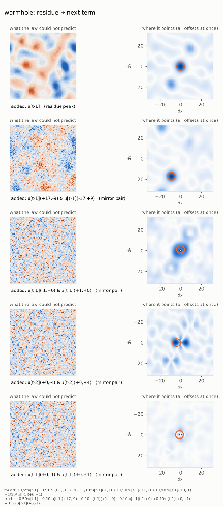
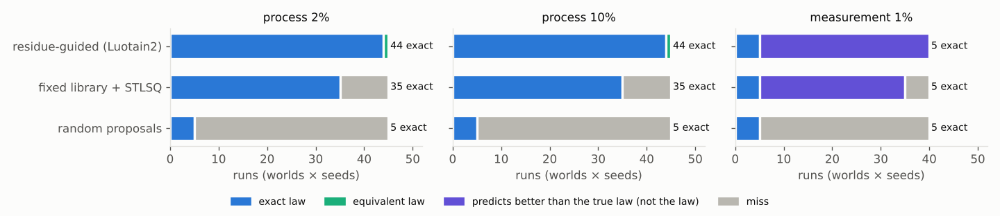
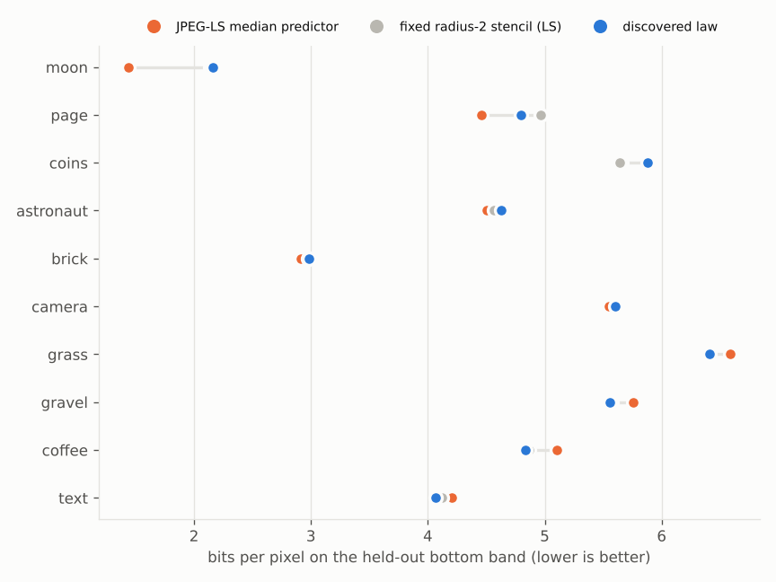
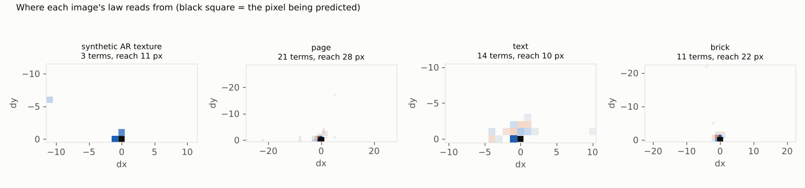

# Luotain2

*Luotain* is Finnish for a sounding probe. [Luotain](https://github.com/anttiluode/Luotain) probed the space of equational laws with small multiplication tables. **Luotain2 probes fields.** Give it a moving field or a still image, and it returns the smallest readable rule that makes the data predictable, for example

```
u[t] = 1/2·u[t-1] + 1/10·(u[t-1] at the four neighbours) + 1/10·u[t-1](+17,−9)
```

and it checks that rule on data the rule never saw. No labels and no neural network. **What the current rule fails to predict (the residue) points at the next term.**

**Site:** [anttiluode.github.io/luotain2](https://anttiluode.github.io/luotain2/) (built from `index.html`; turn on GitHub Pages for `main` / root).

## November 22, 2026 — measurement-noise IV experiment (not yet a discovered law)

[**IV Gate 001: read the experiment and its stop conditions**](IV_WAIVES_GATE.md) · [IV estimator](luotain2/iv.py) · [Original-world benchmark script](scripts/run_iv_gate.py).

The uploaded WAIVES manuscript (Ruzayqat, Bortz and Dukić, 2026, arXiv:2611.23951v2) inspired a **disjoint-time instrumental-variable coefficient estimator**. The original residue-guided discoverer and its 1% measurement-noise failure are unchanged. The new method first receives the **known correct list of terms**, estimates its coefficients from noisy observations and compares against matched OLS on a separately generated clean synthetic test trajectory. An ill-conditioned instrument matrix returns **not identified**, never an invented success.

This is a discrete-time IV-inspired diagnostic, **not WAIVES's continuous-time SDE weak form**, not SPDE theory, not a new blind noise-variance estimator, and **not yet recovery of the unknown law**.

**First measured gate:** with the correct terms supplied, disjoint-time IV improved coefficient recovery in **29/35** original 1%-sensor-noise cases, reducing mean coefficient L2 from **0.012582** (matched OLS) to **0.000358**. But with **2% process + 1% sensor noise**, IV won only **8/15** and had **worse** mean error (**0.016027** versus OLS **0.004766**). One wave trial was badly unstable. The [full workflow and downloadable JSON receipts](https://github.com/anttiluode/Luotain2/actions/runs/45019269055) are preserved. This is a positive coefficient-estimation control with a real negative result, **not** a solved 0/35 blind-discovery benchmark. Passing this test would justify—not prove—a later open-grammar IV proposal/validation experiment. The `tests/test_iv.py` suite includes a noisy autoregression recovery, polynomial corrected-score checks, instrument time-separation and an explicit rank-deficiency refusal.

## November 22 — Gate IV-002: blind linear-law support search

[**Read Gate IV-002 methods, controls and independent evaluation protocol**](IV_BLIND_GATE.md) · [Blind selector](luotain2/blind_iv.py) · [Benchmark script](scripts/run_blind_iv_gate.py).

This separate, experimental branch now proposes **unknown linear shift terms** using Luotain2's FFT residual search, fits candidates with time-disjoint IV, and selects supports using a sensor-noise-corrected validation loss. The true term list and coefficients are hidden until scoring. Nonlinear terms are **out of scope**. A conventional local four-neighbor stencil is explicitly offered as a challenger; its success must not be confused with open nonlocal discovery.

**Development pilot:** first blind search recovered **1/4** exact (only null). After revising local candidate groups, exchange moves and sparsity penalty using the same seed, the revised search recovered **3/4** (heat, drift and null; wormhole missed). The pilot is *development data*, not independent evidence.

**Frozen fresh seeds 201–205:** **25/35 exact including 5 nulls**, or **20/30 non-null linear** (heat 5/5, drift 5/5, wave 5/5, delayed echo 5/5, diagonal 0/5, wormhole 0/5, null 5/5). **Combined 2% process + 1% sensor noise:** **9/10 exact**, including wormhole 2/2. The repeatable measurement-only wormhole failure fits a spurious two-frame autoregression instead of its distant spatial link; process noise may increase excitation but that mechanism remains to be tested. [Full 35+10 JSON and workflow](https://github.com/anttiluode/Luotain2/actions/runs/45019980713) · [Persistent summary](results/blind_iv_summary.json). This is an experimental, *linear-only* synthetic generator benchmark with a known sensor-noise level and a supplied local-stencil challenger, not a verified general solution or a scientific breakthrough. A frozen-parameter [GitHub workflow](.github/workflows/blind_iv.yml) tests 35 fresh-seed cases (30 non-null linear and five null) plus ten combined-noise stress cases; it is not identical to the original 35-case **non-null and partly nonlinear** Luotain2 benchmark.

**Frozen excitation follow-up (new seeds 301–303):** with 1% relative sensor noise, the exact recovery rate for the combined wormhole + diagonal worlds was **0/6** at 0% process noise, **1/6** at 0.5%, and **6/6** at each of 1%, 2%, and 4%. The result supports an excitation-dependent identifiability explanation for these two synthetic systems, but changing the process noise also changes the latent amplitude distribution and absolute sensor noise. [Workflow and raw results](https://github.com/anttiluode/Luotain2/actions/runs/45020756202) · [Compact summary](results/iv_excitation_summary.json). No general theory or real-world validation is claimed.

## November 22 — First real EEG signal instrument

[**EEG Result 001**](EEG_RESULT_001.md) · [public EEG pilot](scripts/eeg_physionet_pilot.py) · [reproducible GitHub run](https://github.com/anttiluode/Luotain2/actions/runs/45022967372).

We analyzed two real public PhysioNet EEG baselines (S001, eyes open/closed; 64 electrodes recorded at 160 Hz, eight selected for this pilot). Posterior alpha-band power (8–12 Hz relative to 4–30 Hz) increased from **22.3% eyes open** to **70.2% eyes closed**. Eight-electrode held-out AR(1) prediction favored **ridge OLS over earlier-lag IV** in both conditions. A rigorous synthetic mixing null showed **72.1% apparent off-diagonal sensor-model weight with zero true source connections**. No neural wiring or medical diagnosis was inferred; EEG is a mixed sensor signal, not a periodic 2-D field.

## November 22 — Fixed absolute sensor variance and matched IV/OLS control

[**Frozen paired-ablation workflow**](.github/workflows/fixed_r_ablation.yml) · [matched OLS/IV branch](luotain2/blind_iv.py) · [tests](tests/test_fixed_r_ols_iv.py).

**Verified completed ablation:** 30 unseen synthetic trials per estimator on identical measurements, with absolute **sensor-noise SD 0.01** and globally matched **latent field SD 0.25** (**4% relative sensor noise**, intentionally tougher than the original 1%). Exact law recovery for increasing process-noise settings (0%, 0.5%, 1%, 2%, 4%) was **IV: 0/6, 3/6, 6/6, 6/6, 6/6** versus **matched OLS: 0/6, 0/6, 0/6, 6/6, 6/6**. Both use the same regression time rows, noise-corrected validation rule and candidate proposal algorithm; their exact proposed supports may diverge after the first fit. **IV 21/30 versus OLS 12/30**, under two synthetic linear law families, is evidence of excitation and estimator-specific support recovery, not a new general theorem. [Verified workflow with two JSON artifacts](https://github.com/anttiluode/Luotain2/actions/runs/45022617505) · [Full method and limits](FIXED_R_GATE.md) · [Result summary](results/fixed_r_ols_iv_summary.json).

## November 22 — Gate IV-004: nonlinear laws, blind, under sensor noise

[**Frozen method and results**](POLY_GATE.md) · [selector](luotain2/blind_poly.py) · [driver](scripts/run_poly_gate.py) · [tests](tests/test_blind_poly.py) · [receipt](results/poly_gate.json).

The blind search now covers the full grammar (u, u², u³, nearby products). Validation uses an **exact Hermite corrected score**: an unbiased estimate of the latent one-step error of any polynomial law, computed from noisy frames and a known sensor variance. For linear laws it reduces to the IV-002 formula. On 3 new seeds per cell, with sensor noise 1–8% and 2% process noise, exact support recovery on Allen–Cahn and Burgers was **22/24 (IV) and 21/24 (OLS) with the exact score**, against **13/24 and 14/24** when the linear recipe is applied to nonlinear terms. That recipe fills the law with lag-2 and lag-3 denoising copies. Linear controls tie (23/24 vs 23/24), and null worlds gave 0 false positives in 48 selections. OLS matched IV here; with OLS, Allen–Cahn at 8% stalls after one term. Synthetic, known Gaussian R, one excitation level: see the limits in the report.

## The loop

1. Fit the current law on the training split. What it cannot predict is the **residue**.
2. **The residue proposes.** For each base field (u, u², u³ at each delay) one FFT cross-correlation scores every possible shift at once. The score is order-recursive: what the terms already in the law can explain is projected out first, so smooth fields do not make every nearby shift look equally good. Products of nearby values are scored directly. The peaks are the proposals.
3. **Probes kill.** Each proposal is refitted on a 20,000-pixel sample; if it does not help on a separate validation sample it is killed without a full fit.
4. **Symmetry moves.** Each proposal is also tried together with its mirror image, and missing mirror images of terms already in the law are offered, one at a time and all together.
5. **Validation decides.** A survivor joins only if it lowers the error on the validation split (data its coefficients never saw) by at least 0.25% per added term. When nothing passes, the loop tries **exchanging** one term of the law for a proposal.
6. **Prune and read.** Terms that stopped paying are dropped. Coefficients are snapped to simple fractions (denominator ≤ 20) when that costs under 0.2% on validation. The final law is scored once on a third, untouched test split.

The law is saved as plain JSON. `luotain2/certify.py` is an independent ~40-line numpy re-implementation that re-scores any law, so a claim can be checked without trusting the search.



*Hidden law: local averaging plus a link to the pixel 17 rows down, 9 columns left. Left: what the law so far cannot predict. Right: how much that residue wants each shift. After the first term the residue points straight at (+17, −9).*

## Results

Full tables: [RESULTS.md](RESULTS.md). Raw numbers: `results/`.

### Mystery worlds: was the hidden law recovered?

Nine fields made by known laws: heat; diffusion along a diagonal; drift; the wave equation (needs the frame two steps back); Allen–Cahn (a cubic term); a "wormhole" link to the pixel at (+17, −9); Burgers (a product term); a delayed echo (three frames back at (−11, +23)); and a null world with no law. Five fresh seeds each (101–105; seeds 1–5 were used while developing), with independent train, validation and test trajectories.



| runs recovering the exact law | Luotain2 | fixed library + STLSQ | random proposals |
|---|---:|---:|---:|
| process noise 2% (45 runs) | **44** (+1 equivalent) | 35 | 5 (null world only) |
| process noise 10% (45 runs) | **44** (+1 equivalent) | 35 | 5 (null world only) |
| measurement noise 1% (40 runs) | 5 (null world only) | 5 (null world only) | 5 (null world only) |
| wormhole + echo, both process levels (20 runs) | **20** | 0 | 0 |

### Ledger

**Verified**

- **Noise inside the dynamics** (each new frame gets 2% or 10% noise that becomes part of the state): the exact law in 44 of 45 runs at each level. The 45th was an *equivalent* law: Burgers came out as `u(x+1)² − u(x−1)²`, the conservative form of the same equation, instead of `u·(u(x+1) − u(x−1))`.
- **Terms no stencil lists:** wormhole (+17, −9) and delayed echo (lag 3, (−11, +23)) were exact in 20 of 20 runs. The fixed radius-2 library found 0 of 20, with held-out error 1.04–6.4× the true law's.
- **Guidance is what works:** the same loop with random proposals from the same open grammar recovered no non-null law, with held-out errors 3× to 2,300× the true law's.
- **No false laws:** the null world returned nothing in all 15 runs.
- **Known still-image law:** a synthetic causal texture came out exact, `9/20·u(0,−1) + 7/20·u(−1,0) + 3/20·u(−6,−11)`.
- **Real text and page images:** the law reaches repeated character and line structure far away (on the page: (0,−8), (0,−22), (0,−28), (−17,+5)) and beats every fixed linear stencil. On the text image it also beats the JPEG-LS median predictor.
- **Certificates:** the independent re-scorer agrees with the engine to 1e-9 (unit test).

**Failed or open**

- **Measurement noise** (1% added only to what is observed): no non-null law recovered by either method. Averaging noisy earlier frames cleans the input, so the best predictor uses extra terms and predicts held-out data *better* than the true law (down to 0.43× its error; the fixed library also misses outright in 5 runs). Recovering the law itself needs a noise model (errors-in-variables). Not done.
- **Natural photographs:** roughly a tie with a fixed radius-2 stencil. The JPEG-LS median predictor wins on brick, camera, moon and astronaut, because edges need a nonlinear switch a linear law does not have. On coins the law is worse: it stopped at 3 terms, and the validation band differs from the test band.
- **Real video:** on the cockatoo clip the 4-term law (0.1265 test NMSE) barely beats "nothing changes" (0.1302). A dense 40-term library regression wins clearly (0.1061). A bird is not a sparse law.
- **Speed:** when the law lies inside its stencil, the fixed library is as accurate and faster (median 1.0 s vs 2.7 s).
- **Grammar limits:** shifts of u, u², u³ at any offset and delay, and products of nearby values. No space-varying coefficients and no hidden variables.
- **Tuning:** thresholds (0.25% per term, 20,000-pixel probes) were set on development seeds of the same worlds.

### Real still images (bits per pixel on the held-out bottom band; lower is better)

For a still image the law predicts each pixel from pixels already decoded, so it is a lossless-coding predictor. These are bare predictors; real coders add context modelling on top.

| image | terms | reach px | JPEG-LS median | LS radius 2 | discovered law |
|---|---:|---:|---:|---:|---:|
| brick | 11 | 22 | 2.912 | 2.973 | 2.980 |
| grass | 7 | 3 | 6.583 | 6.405 | 6.407 |
| gravel | 13 | 4 | 5.759 | 5.574 | **5.559** |
| camera | 6 | 3 | 5.550 | 5.618 | 5.604 |
| moon | 16 | 4 | 1.440 | 2.135 | 2.158 |
| coins | 3 | 2 | 5.657 | 5.639 | 5.883 |
| text | 14 | 10 | 4.208 | 4.119 | **4.066** |
| page | 21 | 28 | 4.457 | 4.968 | 4.796 |
| astronaut | 6 | 3 | 4.506 | 4.568 | 4.625 |
| coffee | 6 | 3 | 5.103 | 4.867 | **4.835** |





## What is old and what is not

Every ingredient is known. Matching pursuit and its order-recursive form (Pati 1993; Natarajan 1995), sparse regression of dynamics from a term library (SINDy, Brunton et al. 2016; PDE-FIND, Rudy et al. 2017), stepwise selection with exchange moves (Efroymson 1960), computing correlations at every shift with the FFT (template matching), and least-squares lossless image predictors.

What Luotain2 adds is the combination as one instrument. The grammar is open: any offset up to the margin, any delay, local nonlinearities and products. Nothing is enumerated in advance, because the residue proposes through the FFT. Luotain-style cheap probes kill most proposals, symmetry moves complete mirror pairs, every acceptance is made on held-out data, and the output is a law with fractions plus a certificate. The benchmark shows when that matters: a fixed library recovers local laws just as well, but it cannot reach a term it did not list (the wormhole and the delayed echo), and unguided search over the same open grammar finds nothing.

## Run it

```
pip install -r requirements.txt
python -m pytest -q tests                      # 7 tests, about 15 s
python scripts/run_worlds.py                    # mystery-world benchmark  -> results/worlds.json
python scripts/run_worlds.py --worlds echo --out results/stress.json
python scripts/run_images.py                    # real images              -> results/images.json
python scripts/run_video.py --video clip.mp4    # any video file
python scripts/run_video.py --camera 0          # your webcam
python scripts/make_figures.py && python scripts/build_report.py
```

The cockatoo clip used below is `cockatoo.mp4` from [imageio/test_images](https://github.com/imageio/test_images) (not stored in this repository).

## Files

| path | what |
|---|---|
| `luotain2/grammar.py` | the terms a law can contain |
| `luotain2/stream.py` | frames, masks, cached term fields |
| `luotain2/discover.py` | the loop: residue proposals, probes, symmetry, exchange, pruning, fractions |
| `luotain2/baselines.py` | controls: fixed library + STLSQ; random proposals live in `discover.py` |
| `luotain2/worlds.py` | mystery worlds with known laws, and a causal texture with a known law |
| `luotain2/coding.py` | bits-per-pixel, JPEG-LS median predictor, fixed causal stencils |
| `luotain2/certify.py` | independent re-scoring of a saved law |
| `scripts/` | benchmark, real images, real video, figures, report |
| `results/` | every number in this README, as JSON |
